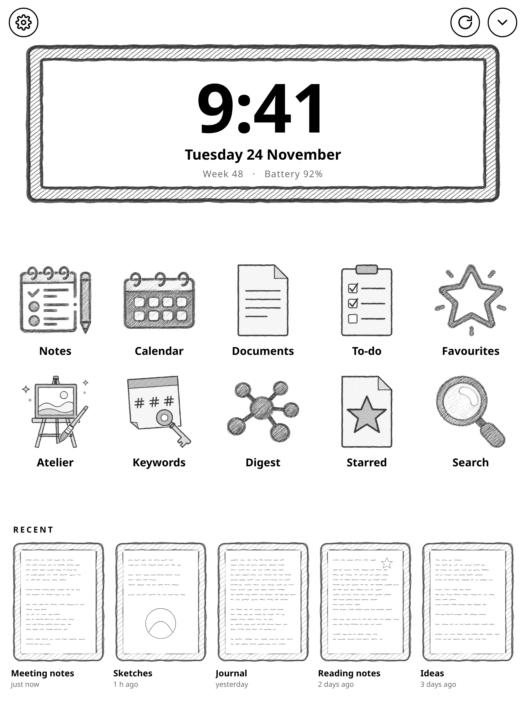
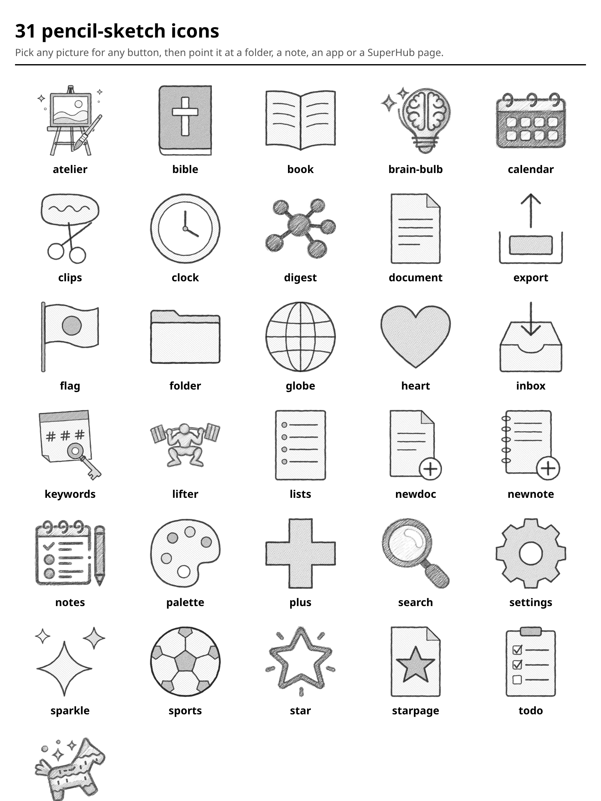

# SuperHub

**SuperHub** is a calm home screen for Supernote: a clock, ten pencil-sketch buttons you name and point at anything, and your recent pages at a glance.

SuperHub is based on [SuperDashboard](https://github.com/AgP42/SuperDashboard) by **AgP42**, used under the MIT licence. Thank you to AgP42 for the original plugin.



## What it does

- **Home screen**: a framed clock (date, week number, battery), ten buttons in two rows of five, and your most recent pages as previews. Tap a preview to open it.
- **Buttons are yours**: give each button a picture, a name, a place on the screen, and something to open:
  - a folder, or a note or document
  - any app installed on your Supernote
  - a SuperHub page: Favourites, Starred pages, Keywords, Search, Note Clips or To-do
  - a **new note**, where you choose its name, folder, page style, handwriting recognition and orientation
  - a **new typed document**, opened in the Supernote's own document editor
  - today's notebook in a folder of dated notebooks (`YYYY/YYYY-MM-DD.note`), for a planner or journal
- **31 pencil-sketch icons**, or your own pictures.
- **Starred pages**: every page you drew a five-point star on, as a grid of previews.
- **Note Clips and To-do**: lasso something in a note and tap *SuperHub Clip* or *SuperHub To-do* in the lasso toolbar.



## Install

You need Supernote firmware with plugin support: Chauvet **3.29.43 or later** on Manta and Nomad (2.26.40 or later on A5 X and A6 X). SuperHub has been tested on a Manta with 3.31.45.

**From InkHub** (once SuperHub is listed there): open InkHub on your Supernote, find SuperHub under Plugins, and install it.

**From this page**:

1. Download `SuperHub.snplg` from [Releases](https://github.com/weedwhitesandwine/SuperHub/releases/latest).
2. Copy it into the **MyStyle** folder on your Supernote (USB cable, Browse & Access, or your cloud sync).
3. On the Supernote: **Settings → Apps → Plugins → Add Plugin**, and choose `SuperHub.snplg`.

## Open it

1. Open any note. In the toolbar, tap the plugin button (the puzzle piece) and choose **SuperHub**.
2. The first time, allow file access when asked. SuperHub needs it to show your files and save its settings. It never uses the internet.
3. SuperHub opens on its settings page. Set up your buttons, then tap **Done**.
4. From then on, a small **house** floats over every screen. Tap it to open SuperHub from anywhere; drag it to move it. (You can hide it in settings and use the toolbar button instead.)

## Set up your buttons

Tap the **gear** at the top left of SuperHub. Tap one of the ten buttons, then:

- **Name**: type the name shown under it.
- **Opens**: choose a folder, a note or document, an app, a SuperHub page, a new note, a new typed document, or today's notebook.
- **Picture**: choose one of the icons.
- **Place**: choose its position, 1 to 5 on the top row, 6 to 10 on the bottom row.

A fresh install starts with New note, Calendar, To-do and Digest; the other six are empty for you to fill.

**Your own pictures**: copy square PNG or JPG files into `MyStyle/SuperHub/Icons` on your Supernote, then reopen settings. They appear after the built-in icons.

## Your settings

Settings are saved as you change them, in `MyStyle/Plugins/SuperHub/config.json`, with an automatic backup beside it. Updating or reinstalling SuperHub keeps them. Under **Saved copies of your settings** you can keep named copies and bring them back.

## Permissions

- **File read and write**: to list and open your notes and folders, show previews, make new notes, and save settings in MyStyle.
- **No internet**: SuperHub works entirely on your Supernote and sends nothing anywhere.

## Build from source

```bash
./buildPlugin.sh           # -> build/outputs/SuperHub.snplg
bash icon-src/build.sh     # regenerate the icons from icon-src/
```

Needs Node 22, JDK 21 and the Android SDK (platform 35, build-tools 35.0.0, NDK 27.1, CMake 3.22). React Native is fixed at 0.79.2 to match the Supernote's plugin host.

## Licence

MIT. See [LICENSE](LICENSE). SuperHub keeps AgP42's SuperDashboard copyright notice alongside its own.
